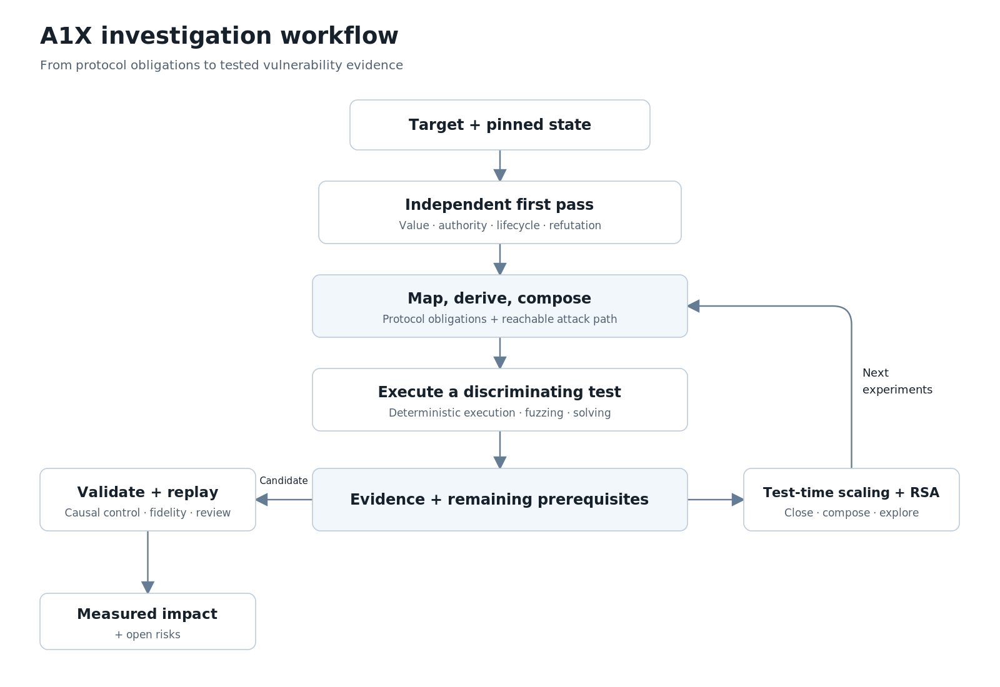

# A1X

**Execution-guided smart contract vulnerability research with test-time scaling and recursive self-aggregation.**

A1X is a Solidity/EVM investigation framework for Codex. Specialized skills guide protocol analysis, reachable attack construction, and adversarial validation. A Python runtime records the campaign, launches worker lanes, and preserves experiments and evidence.

Its central search policy separates three kinds of work: **continue a partial exploit**, **test a composition of two leads**, and **explore independently**. The aim is to give promising mechanisms enough depth while maintaining discovery breadth.

**Runtime:** `4.3.0` · **Primary agent:** Codex · **Execution:** local simulations and pinned forks · **Status:** research prototype



*The coordinator revisits earlier steps as evidence changes. Tools are selected for the current question.*

[Quick start](#quick-start) · [Workflow](#investigation-workflow) · [Test-time scaling](#test-time-scaling) · [RSA](#recursive-self-aggregation-rsa) · [Skills](#skill-map) · [Research](#research-and-evaluation) · [Commands](a1x-runtime/references/command-guide.md)

## What A1X investigates

A1X searches for contradictions between protocol obligations and attacker-reachable behavior. A typical question is whether one function can establish state that another function trusts too strongly: a stale claim, an incorrectly valued balance, a reusable authorization, or an incomplete lifecycle transition.

The agent maps code and deployed state, defines a security property, constructs the shortest reachable sequence, and chooses an experiment that separates the hypothesis from its strongest innocent explanation. Partial witnesses, failed experiments, exact blockers, and refutations remain part of the investigation.

The workflow covers accounting and economic logic, authorization, governance, upgrades, callbacks, settlement, and liveness. Impact is measured against the relevant security property, including consequences that do not immediately produce attacker profit.

### Two cooperating layers

| Layer | Responsibility |
| --- | --- |
| **Investigation skills** | Protocol reasoning, obligation derivation, actor modeling, attack composition, tool selection, and validation. |
| **Campaign runtime** | Campaign identity and budgets, worker execution, plans and receipts, evidence and replay records, lineages, prerequisites, reserves, and completion state. |

Codex supplies reasoning and writes target-specific experiments. Foundry, fuzzers, solvers, and RPC observations supply evidence. The runtime checks artifact relationships and declared outcomes; protocol validity still requires inspection of the actual behavior.

## Investigation workflow

1. **Establish the target.** Record the source snapshot, deployment boundary, chain, pinned block, authorized methods, and resource budget.
2. **Start independently.** Four bootstrap lanes investigate value/numerical behavior, authority/trust, lifecycle/composition, and adversarial refutation before exchanging conclusions.
3. **Derive obligations.** State what must hold, for which actors, at which boundary, in which units, and with which exceptions. Map critical writers, guards, and consumers.
4. **Construct a reachable path.** Make capital, approvals, actor capabilities, callbacks, time, ordering, transaction boundaries, and dependency assumptions explicit.
5. **Run a discriminator.** Choose deterministic execution, focused stateful fuzzing, or bounded solving. Record observations separately from interpretations.
6. **Allocate the next work.** Continue partial witnesses, test compatible compositions, preserve alternatives, and introduce independent perspectives.
7. **Validate and extend.** Challenge causality and setup fidelity; replay cleanly; review the claim; investigate downstream consequences. Candidate creation schedules four expansion lanes: impact extension, alternate consumer, strongest refutation, and causal minimization.
8. **Close explicitly.** Report demonstrated candidates, refutations, open risks, and blockers. The controller distinguishes clean, open-risk, budget-exhausted, and environment-blocked closure.

See [a1x-hunt](a1x-hunt/SKILL.md) for the complete policy.

## Test-time scaling

**Test-time scaling (TTS)** allocates additional inference compute while solving a task. A1X also allocates execution resources: worker time, tests, fuzzing campaigns, and solver jobs. It does not train a model or update its weights.

| Dimension | A1X behavior |
| --- | --- |
| **Parallel breadth** | Independent workers investigate different obligations, actors, consumers, lifecycle states, or refutations. |
| **Sequential depth** | A worker continues an executed prefix and addresses its next unresolved prerequisite. |
| **Recursive composition** | Later generations receive selected parent components and test whether they compose. |
| **Evidence-informed allocation** | Selection considers mechanism diversity, witness progress, prerequisites, setup fidelity, and evidence. Distinct overflow leads remain in reserve. |

Additional compute is useful when it resolves uncertainty or reaches a relevant state. Compilation repairs are recorded separately from mechanism progress. New wording and higher self-reported confidence do not establish advancement.

Stagnation is tracked by lineage so unrelated discoveries cannot reset a stalled partial exploit's progress history. Evolution is bounded by generation, lane, parallelism, timeout, and campaign limits. These controls do not automatically enforce monetary or token budgets.

## Recursive self-aggregation (RSA)

RSA iteratively creates new candidates from subsets of an existing population. A1X adapts the idea to vulnerability investigation by passing **grounded components and their artifacts** between generations: mechanisms, state prefixes, actor requirements, constraints, observations, and unresolved prerequisites.


*The three middle branches mean: continue one promising idea (K=1), combine two compatible ideas (K=2), or explore independently. Results guide the next round; possible bugs receive replay and further checks.*

| Lane role | Input | Assigned task |
| --- | --- | --- |
| **K=1: witness closure** | One partial witness and its exported artifacts | Advance the same target, mechanism, and consumer by addressing the first open prerequisite. |
| **K=2: composition** | Two grounded parent handoffs and their exported artifacts | Check actor, state, capital, ordering, and prerequisite compatibility; execute a composed child when feasible. |
| **Fresh search** | An independent question without parent conclusions | Explore another mechanism or state shape and run a cheap discriminating experiment. |

**K is the number of parent handoffs supplied to a child.** K=1 provides protected continuation; K=2 provides pairwise RSA-style recombination. Fresh lanes maintain breadth. Their allocation is configurable.

A composition remains a hypothesis to test. Incompatible parents stay separate. Children are assessed against their parents, and demonstrated candidates still require validation.

### Why protect a partial witness?

Suppose a vault experiment measures accounting drift but cannot yet reach withdrawal. A closure lane receives the harness and the unresolved settlement prerequisite. It continues that mechanism while other lanes explore compatible prefixes or different explanations.

Economic witnesses can use `prepare → trigger → persist → settle → realize → impact` phases. Authorization, governance, upgrade, settlement, and liveness witnesses have their own profiles. A reached phase is an intermediate observation, not automatically a vulnerability.

Read [population design](a1x-scale/references/population-design.md), [recursive aggregation](a1x-scale/references/recursive-aggregation.md), and [runtime scaling](a1x-runtime/references/scaling-runtime.md) for the detailed policy.

## Skill map

| Package | Role |
| --- | --- |
| [a1x](a1x/SKILL.md) | Compatibility entry point; routes full investigations to `a1x-hunt`. |
| [a1x-hunt](a1x-hunt/SKILL.md) | Coordinates investigation, specialist routing, expansion, and completion. |
| [a1x-runtime](a1x-runtime/SKILL.md) | CLI/MCP, event-sourced state, execution records, evidence, forks, replay, and scheduling. |
| [a1x-recon](a1x-recon/SKILL.md) | Reconstructs deployments, actors, asset flows, dependencies, and transitions. |
| [a1x-obligations](a1x-obligations/SKILL.md) | Defines obligations, falsifiable hypotheses, and security oracles. |
| [a1x-compose](a1x-compose/SKILL.md) | Builds reachable multi-call, multi-actor, callback, and multi-transaction sequences. |
| [a1x-execute](a1x-execute/SKILL.md) | Runs controlled experiments and records observations, metrics, and controls. |
| [a1x-fuzz](a1x-fuzz/SKILL.md) | Designs focused stateful campaigns with realistic handlers and independent oracles. |
| [a1x-solve](a1x-solve/SKILL.md) | Resolves bounded numeric, symbolic, timing, ordering, and boundary constraints. |
| [a1x-scale](a1x-scale/SKILL.md) | Manages independent populations, continuation, RSA, reserves, and progress. |
| [a1x-validate](a1x-validate/SKILL.md) | Challenges reachability, fidelity, causality, impact, and replay. |

## Quick start

### Requirements

Use Linux, **Python 3.11+**, Git, and a compatible authenticated Codex CLI. Fork investigations also need Foundry (`forge`, `cast`, `anvil`) and a chain RPC configured on the trusted host. Historical experiments need an endpoint capable of serving the selected state.

`doctor` inspects tools and sandbox readiness. Linux namespace restrictions can block population execution. Wake, Echidna, Medusa, ItyFuzz, Halmos/Z3, Slither, and Aderyn are optional specialists. Their availability and target compatibility must be checked; the agent still constructs appropriate harnesses and interprets outputs.

### Install

```bash
git clone https://github.com/GambitPlayer90/A1X.git
cd A1X

# Refuse to overwrite an existing installation.
mkdir -p "$HOME/.agents/skills"
for skill in a1x a1x-*; do
  if [ -e "$HOME/.agents/skills/$skill" ]; then
    echo "Existing skill: $skill. Back it up before installing." >&2
    exit 1
  fi
done
for skill in a1x a1x-*; do
  cp -a "$skill" "$HOME/.agents/skills/$skill"
done

A1X_CLI="$HOME/.agents/skills/a1x-runtime/scripts/a1x"
python3 "$A1X_CLI" --version
python3 "$A1X_CLI" doctor
```

For archives that discard executable permissions, restore them on `a1x`, `a1x-lane-fork`, and `a1x-lane-fork-mcp` in the installed runtime's `scripts/` directory.

### Start an investigation in Codex

Invoke `$a1x-hunt` (or `$a1x`) with a concrete scope:

```text
$a1x-hunt

Investigate the authorized Solidity target at /absolute/path/to/protocol.
Deployment: <address>, chain <chain-id>, pinned block <block-number>.
The host RPC is configured as MAINNET_RPC_URL; keep its value out of artifacts.

Use local simulations and pinned local forks. Preserve target sources.
Create a campaign outside the target compilation tree.
Budget: 200 recorded runs, 32 scale lanes, at most 4 parallel workers.
Return replayable candidates, causal controls, measured consequences,
refutations, and exact unresolved prerequisites.
```

The coordinator routes to companions when their conditions apply. Installing the folders alone does not launch an investigation.

### Operate a campaign explicitly

Replace paths and deployment values below. `MAINNET_RPC_URL` names a variable already configured on the host.

```bash
A1X_CLI="$HOME/.agents/skills/a1x-runtime/scripts/a1x"
A1X_ROOT="$HOME/audit-work/example-campaign"

python3 "$A1X_CLI" campaign init \
  --root "$A1X_ROOT" --label example-campaign \
  --source /absolute/path/to/protocol --target '<deployment-address>' \
  --chain-id 1 --block 12345678 --rpc-env MAINNET_RPC_URL \
  --authorization "Authorized local fork testing" \
  --max-runs 200 --max-scale-lanes 32 --max-parallel 4

python3 "$A1X_CLI" capability probe --root "$A1X_ROOT"
python3 "$A1X_CLI" campaign show --root "$A1X_ROOT"
```

Initialization returns a `mandatory_bootstrap_round`. Use its returned ID:

```bash
A1X_ROUND='<returned-bootstrap-round-id>'
python3 "$A1X_CLI" scale run --root "$A1X_ROOT" \
  --round "$A1X_ROUND" --parallel 4 \
  --sandbox workspace-write --lane-forks require
python3 "$A1X_CLI" scale aggregate --root "$A1X_ROOT" \
  --round "$A1X_ROUND"
```

`--lane-forks require` fails if a pinned lane fork cannot be allocated; `auto` allocates one when context permits; `off` is for experiments that do not need one. The examples explicitly select `workspace-write`; v4.3.0 scale execution otherwise defaults to `danger-full-access`. Environment scrubbing and separate workspaces are not a complete OS sandbox.

Once grounded leads exist, an example evolution command is:

```bash
python3 "$A1X_CLI" scale evolve --root "$A1X_ROOT" \
  --parent-round "$A1X_ROUND" \
  --generations 3 --children 3 --closure-lanes 1 --fresh-lanes 1 \
  --stagnation-rounds 2 --parallel 4 \
  --sandbox workspace-write --lane-forks require
```

`--children` is the closure-plus-composition capacity per generation; fresh lanes are additional. Actual allocation depends on eligible parents and available pairs. Omit `--model` and `--reasoning` to inherit Codex defaults, or set them explicitly for reproducibility.

The [command guide](a1x-runtime/references/command-guide.md) covers plans, observations, controls, replay, review, downstream impact, and closure.

## Evidence and reproducibility

A campaign retains source/deployment identity, obligations, hypotheses, plans and receipts, observations, content-addressed artifacts, worker handoffs, lineages and prerequisites, replays, reviews, impact branches, and completion state.

| Evidence ceiling | Intended meaning |
| --- | --- |
| E0–E2 | Recorded mechanism, code grounding, and reachability justification. |
| E3 | A concrete experiment reaches the predicted suspicious state. |
| E4 | A property violation has a causal negative control. |
| E5 | Implementation, configuration, actor, and economic fidelity are declared. |
| E6 | Clean mechanical replay and a qualifying fresh-process review are linked. |

These are **mechanical ceilings over records and declarations**. Artifact hashes do not prove interpretation; a review process does not itself establish independent reproduction; a passing replay does not establish the security oracle's correctness. See the [artifact contract](a1x-runtime/references/artifact-contract.md) and [current limitations](docs/research-and-limitations.md).

For backtests, pin before the incident and withhold its exploit transaction, published PoC, and answer-bearing reports. Separate fixture authority from attacker capabilities and local demonstrations from deployed applicability.

## Optional campaign MCP

The local stdio MCP server exposes campaign inspection, evidence verification, capability inspection, experiment routing, RSA graph construction, and host-side explorer retrieval:

```bash
/bin/bash -ic 'exec python3 "$HOME/.agents/skills/a1x-runtime/scripts/a1x" mcp stdio'
```

Register this command in a compatible MCP client. Other agents can read the reasoning skills, but this version launches population workers through `codex exec`; arbitrary MCP-client support is not provider-neutral worker execution.

## Research and evaluation

A1X implements a method for studying **whether witness-preserving search improves vulnerability discovery at matched cost**. The repository does not establish superiority over A1, a benchmark success rate, or a speedup over fuzzing or symbolic execution.

Compare sequential execution-feedback retries, independent parallel workers, ordinary RSA, A1X without protected closure, A1X without pairwise composition, and the full policy. Hold model, tools, target information, and budgets constant when isolating controller effects.

Measure independently adjudicated target success, unique root causes, time/cost to a valid witness, partial-to-complete conversion, and false positives. Include coordinator/reviewer usage and infrastructure failures. Runtime evaluation commands record supplied outcomes and costs; they are not an independent benchmark grader.

See [research design and limitations](docs/research-and-limitations.md) for evaluation boundaries and v4.3.0 integration notes.

### Run the bundled checks

From the repository root:

```bash
PYTHONPATH="$PWD/a1x-runtime/scripts" \
  python3 -m unittest discover -s a1x-runtime/tests -v
```

Inspect skipped tests; Foundry-dependent integration checks need their binaries. These checks assess runtime behavior, not detection effectiveness. A real Codex/Foundry smoke test is a separate requirement.

## Background and attribution

- [**A1: AI Agent Smart Contract Exploit Generation**](https://arxiv.org/abs/2507.05558), Arthur Gervais and Liyi Zhou. A1 motivates execution-guided exploit generation on blockchain state.
- [**Recursive Self-Aggregation Unlocks Deep Thinking in Large Language Models**](https://arxiv.org/abs/2509.26626), Siddarth Venkatraman et al. RSA motivates iterative subset aggregation of candidate populations.

A1X is a separate research implementation. Protected continuation, the evidence/prerequisite representation, and the mixed exploration policy are mechanisms to evaluate; effectiveness and novelty require controlled results and a broader prior-art comparison.

## Documentation and contributions

Start with [a1x-hunt](a1x-hunt/SKILL.md), [runtime commands](a1x-runtime/references/command-guide.md), [scaling](a1x-runtime/references/scaling-runtime.md), and the [evidence architecture](a1x-runtime/references/v4-architecture.md). Editable diagram topology is in [docs/diagrams](docs/diagrams/README.md).

Useful contributions include reproducible integration failures, backend compatibility fixes, independently replayable benchmark cases, and measured policy ablations. Remove credentials and private target information from shared artifacts. Use A1X within an authorized testing scope.
