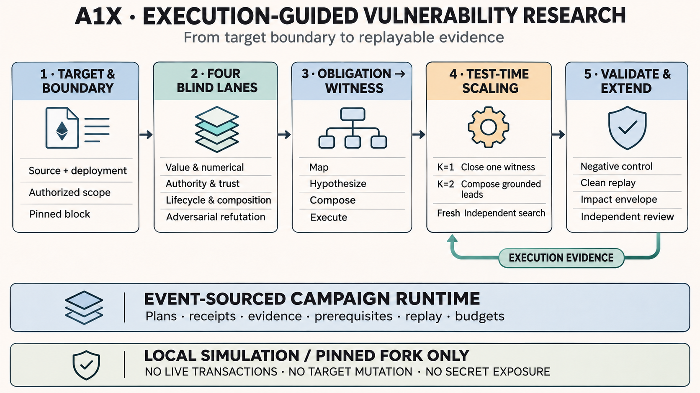

<h1 align="center">A1X</h1>

  <strong>Execution-guided smart-contract vulnerability research for Codex</strong>

  Pinned-fork execution · Test-time scaling · Recursive self-aggregation · Replayable evidence

  <a href="#installation">Install</a> ·
  <a href="#quick-start">Quick start</a> ·
  <a href="#how-a1x-works">Workflow</a> ·
  <a href="#test-time-scaling-and-rsa">Scaling</a> ·
  <a href="#skill-map">Skills</a> ·
  <a href="#evidence-model">Evidence</a>

  A1X turns protocol hypotheses into replayable evidence while preserving independent exploration and strict local-fork boundaries.

A1X is a Solidity/EVM investigation framework for Codex. It combines protocol reasoning with deterministic execution so that an investigation advances through observed state transitions rather than prose alone.

The framework maps source and deployed state, derives security obligations, constructs attacker-reachable witnesses, runs targeted experiments, and preserves the resulting plans, receipts, traces, prerequisites, and replay records in an event-sourced campaign runtime.

> [!IMPORTANT]
> A1X is for authorized research on local simulations and pinned local forks. It does not authorize live-chain transactions, modification of target source, disclosure of credentials, or submission to third parties.

## Why A1X

Smart-contract failures rarely live in one isolated function. They emerge when a producer creates state that a valuable consumer trusts too strongly—across actors, callbacks, accounting boundaries, lifecycle phases, or transactions.

A1X is designed to investigate those chains without collapsing into either a scanner checklist or an unbounded agent loop:

- **Execution-guided:** hypotheses are tested against source-faithful simulations or pinned fork state.
- **Obligation-driven:** each lead starts from a property that must hold for a defined actor, boundary, unit, and exception set.
- **Witness-preserving:** partial exploits, exact blockers, failed experiments, and refutations remain available to later generations.
- **Evidence-calibrated:** a positive trace is not automatically a vulnerability; causality, fidelity, replay, and impact remain separate gates.
- **Budgeted:** campaign limits govern recorded runs, scale lanes, parallel workers, timeouts, and completion.

**Runtime:** 4.3.0 · **Primary agent:** Codex · **Execution boundary:** local simulations and pinned forks · **Project status:** research prototype

## How A1X works

| Stage | Purpose | Durable output |
| --- | --- | --- |
| **1. Target and boundary** | Record the source snapshot, deployment, authorized methods, chain, pinned block, and budget. | Target identity and campaign boundary |
| **2. Four blind lanes** | Investigate value/numerical behavior, authority/trust, lifecycle/composition, and adversarial refutation independently. | Diverse grounded hypotheses |
| **3. Obligation to witness** | Map state, derive a falsifiable mechanism, compose the shortest reachable sequence, and run a discriminator. | Plans, receipts, traces, blockers, and observations |
| **4. Test-time scaling** | Continue partial witnesses, compose compatible leads, and inject fresh independent search. | Lineages, prerequisites, handoffs, and reserves |
| **5. Validate and extend** | Add negative controls, replay cleanly, review independently, and explore downstream impact. | Evidence bundle, replay record, and impact envelope |

The coordinator revisits earlier stages whenever execution reveals an unknown writer, actor, dependency, configuration, or state transition.

### Two cooperating layers

| Layer | Responsibility |
| --- | --- |
| **Investigation skills** | Protocol reconstruction, obligation derivation, actor modeling, attack composition, experiment design, fuzzing, solving, and validation |
| **Campaign runtime** | Campaign identity, budgets, sealed execution, observations, artifacts, lineages, prerequisites, replay, review, and completion state |

Codex supplies target-specific reasoning and experiments. Foundry, RPC observations, fuzzers, and solvers supply evidence. The runtime preserves and checks artifact relationships; it does not replace human judgment about protocol semantics.

## Test-time scaling and RSA

A1X allocates additional inference and execution effort only while new work can resolve material uncertainty or reach a security-relevant state.

| Lane | Input | Assignment |
| --- | --- | --- |
| **K=1 · Witness closure** | One executed partial witness | Preserve the mechanism and address its first open prerequisite |
| **K=2 · RSA composition** | Two grounded parent handoffs | Check actor, state, capital, ordering, and prerequisite compatibility, then test the composed path |
| **Fresh · Independent search** | No parent conclusions | Explore a different mechanism or state shape with a cheap discriminator |

**K is the number of parent handoffs supplied to a child.** K=1 protects sequential depth. K=2 provides pairwise recursive self-aggregation. Fresh lanes preserve breadth.

A composition remains a hypothesis until execution supports it. Incompatible parents stay separate, and demonstrated candidates still pass validation and impact-extension gates.

For economic paths, a witness may progress through:

> prepare → trigger → persist → settle → realize → impact

Authorization, governance, upgrade, settlement, and liveness mechanisms use their own terminal semantics.

## Installation

### Requirements

- Linux
- Python 3.11 or newer
- Git
- An authenticated, compatible Codex CLI
- Foundry (<code>forge</code>, <code>cast</code>, and <code>anvil</code>) for fork investigations
- A historical-state-capable RPC endpoint for the selected chain and block

Optional specialists such as Wake, Echidna, Medusa, ItyFuzz, Halmos/Z3, Slither, and Aderyn are capability-gated. A missing optional backend does not disable unrelated work.

### 1. Clone the repository

Using HTTPS:

~~~bash
git clone https://github.com/GambitPlayer90/A1X.git
cd A1X
~~~

Using SSH:

~~~bash
git clone git@github.com:GambitPlayer90/A1X.git
cd A1X
~~~

### 2. Install the skills

The installer below refuses to overwrite an existing A1X installation.

~~~bash
mkdir -p "$HOME/.agents/skills"

for skill in a1x a1x-*; do
  if [ -e "$HOME/.agents/skills/$skill" ]; then
    echo "Existing skill: $skill. Back it up before installing." >&2
    exit 1
  fi
done

for skill in a1x a1x-*; do
  cp -a "$skill" "$HOME/.agents/skills/$skill"
done
~~~

### 3. Verify the runtime

~~~bash
A1X_CLI="$HOME/.agents/skills/a1x-runtime/scripts/a1x"

python3 "$A1X_CLI" --version
python3 "$A1X_CLI" doctor
~~~

If an archive discarded executable permissions, restore them on <code>a1x</code>, <code>a1x-lane-fork</code>, and <code>a1x-lane-fork-mcp</code> in the installed runtime's <code>scripts/</code> directory.

## Quick start

Invoke <code>$a1x-hunt</code>—or the compatibility entry point <code>$a1x</code>—with a concrete authorized target:

~~~text
$a1x-hunt

Investigate the authorized Solidity target at /absolute/path/to/protocol.
Deployment: <address>, chain <chain-id>, pinned block <block-number>.
The host RPC is configured as MAINNET_RPC_URL; keep its value out of artifacts.

Use local simulations and pinned local forks. Preserve target sources.
Create the campaign outside the target compilation tree.
Budget: 200 recorded runs, 32 scale lanes, at most 4 parallel workers.

Return replayable candidates, causal controls, measured consequences,
refutations, and exact unresolved prerequisites.
~~~

A1X discovers RPC and explorer **variable names** without printing their values. Never paste credentials into a prompt, campaign artifact, test log, commit, or report.

The coordinator creates a mandatory four-worldview blind bootstrap round before narrowing onto one theory. It then routes work to the appropriate reconstruction, obligation, composition, execution, fuzzing, solving, scaling, or validation skill.

See the [full coordinator policy](a1x-hunt/SKILL.md) and [runtime command guide](a1x-runtime/references/command-guide.md) for explicit campaign operation.

## Evidence model

A1X records observations separately from interpretation. Its evidence levels are mechanical ceilings over linked records—not guarantees that an interpretation is correct.

| Level | Meaning |
| --- | --- |
| **E0–E2** | Mechanism recorded, code-grounded, and justified as reachable |
| **E3** | A concrete experiment reaches the predicted suspicious state |
| **E4** | The property violation has a causal negative control |
| **E5** | Implementation, configuration, actor, and economic fidelity are declared |
| **E6** | Clean mechanical replay and a qualifying fresh-process review are linked |

Artifact hashes do not prove protocol meaning. Replay does not prove the oracle. Review does not establish independent reproduction by itself.

A campaign is not complete merely because it contains an E3–E6 candidate. The runtime hierarchy is:

> mechanism found → candidate demonstrated → vulnerability validated → terminal impact demonstrated or bounded → maximum credible consequence explored → campaign closed

## Skill map

| Package | Role |
| --- | --- |
| [a1x](a1x/SKILL.md) | Compatibility entry point that routes complete investigations to A1X Hunt |
| [a1x-hunt](a1x-hunt/SKILL.md) | End-to-end coordination, specialist routing, expansion, and completion |
| [a1x-runtime](a1x-runtime/SKILL.md) | Event-sourced campaign state, CLI/MCP, evidence, forks, replay, and scheduling |
| [a1x-recon](a1x-recon/SKILL.md) | Deployment, actor, asset-flow, dependency, and state-transition reconstruction |
| [a1x-obligations](a1x-obligations/SKILL.md) | Security obligations, falsifiable hypotheses, and oracles |
| [a1x-compose](a1x-compose/SKILL.md) | Reachable multi-call, multi-actor, callback, and multi-transaction sequences |
| [a1x-execute](a1x-execute/SKILL.md) | Controlled experiments, observations, metrics, and causal controls |
| [a1x-fuzz](a1x-fuzz/SKILL.md) | Focused stateful campaigns with realistic handlers and independent oracles |
| [a1x-solve](a1x-solve/SKILL.md) | Bounded numeric, symbolic, timing, ordering, and boundary constraints |
| [a1x-scale](a1x-scale/SKILL.md) | Blind populations, protected continuation, RSA, reserves, and progress |
| [a1x-validate](a1x-validate/SKILL.md) | Reachability, fidelity, causality, impact, independent review, and replay |

## Safety boundaries

A1X's workflow requires:

- preserve target source;
- execute adversarial behavior only in local simulations or pinned local forks;
- separate setup authority from attacker authority;
- keep RPC URLs and API keys out of prompts and artifacts;
- verify deployed applicability at a recorded block;
- distinguish harness repair from hypothesis progress;
- treat scanner output and generated PoCs as leads, not conclusions;
- never submit, disclose, or transact against live assets automatically.

## Research status

A1X implements a method for studying whether witness-preserving search improves vulnerability discovery at matched cost. This repository does **not** establish superiority over A1, a benchmark success rate, or a speedup over fuzzing or symbolic execution.

Evaluation should hold the model, target information, tools, and budgets constant while measuring independently adjudicated target success, unique root causes, time and cost to a valid witness, partial-to-complete conversion, and false positives.

## Further reading

- [A1X coordinator policy](a1x-hunt/SKILL.md)
- [Runtime command guide](a1x-runtime/references/command-guide.md)
- [Population design](a1x-scale/references/population-design.md)
- [Recursive aggregation](a1x-scale/references/recursive-aggregation.md)
- [Scaling runtime](a1x-runtime/references/scaling-runtime.md)
- [Evidence artifact contract](a1x-runtime/references/artifact-contract.md)
- [Runtime architecture](a1x-runtime/references/v4-architecture.md)

## Background and attribution

A1X is a separate research implementation influenced by:

- [A1: AI Agent Smart Contract Exploit Generation](https://arxiv.org/abs/2507.05558), Arthur Gervais and Liyi Zhou
- [Recursive Self-Aggregation Unlocks Deep Thinking in Large Language Models](https://arxiv.org/abs/2509.26626), Siddarth Venkatraman et al.

Protected continuation, the evidence/prerequisite representation, and the mixed exploration policy are mechanisms to evaluate. Effectiveness and novelty require controlled results and broader prior-art comparison.

---

  Use A1X only within an explicitly authorized testing scope.

